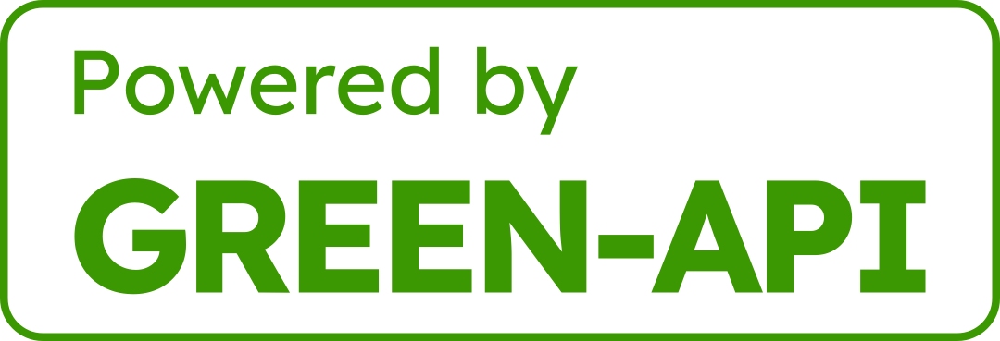

# GREEN-API logo

The GREEN-API logo and icon are the brand's visual identity. Using our logo is important for creating brand consistency.  

The GREEN-API logo is available in three formats: [full](./banner-with-logo-GREEN-API/), [banner without logo](./banner-GREEN-API/), and [icon](./Icon-logo-GREEN-API/).  

We designed three color versions of logos: green on white, white on green, and monochrome.  

All icons are available in three file types: PNG, SVG, and JPEG.  

## GREEN-API logo examples  

  

## GREEN-API affiliate logo to your website  

The GREEN-API affiliate logo is available in [two file types](./powered-by-GREEN-API/): PNG and SVG.

We designed four color versions: green, white, white with green, and monochrome.  

  

## GREEN-API: Marketing  

The GREEN-API: Marketing logo is available in [two file types](./GREEN-API-Marketing/): PNG and SVG.  

We designed two type logos in one green version.  

  
